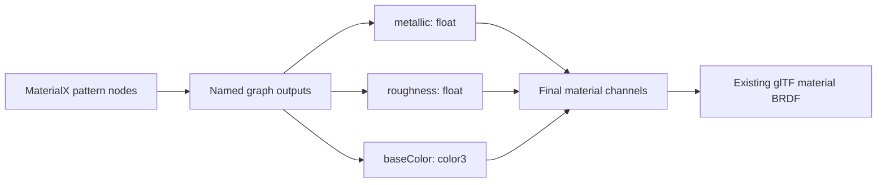

<!--
Copyright 2024-2026 The Khronos Group Inc.
SPDX-License-Identifier: LicenseRef-KhronosSpecCopyright
-->

# KHR_materials_procedural

## Contributors

- Ashwin Bhat, Autodesk
- Alexey Knyazev, Individual Contributor
- Bernard Kwok, Individual Contributor
- Ed Mackey, AGI
- Lutz Kettner, NVIDIA
- Richard Sahlin, IKEA
- Timothy Blut, NVIDIA
- Ben Houston, Individual Contributor

## Status

Draft

## Dependencies

Written against glTF 2.0. The key words **MUST**, **MUST NOT**, **REQUIRED**, **SHOULD**, **SHOULD NOT**, and **MAY** are to be interpreted as described in the glTF specification.

## Overview

This extension defines procedural graphs that compute glTF material inputs from constants, geometric streams, and sampled resources. Graphs use MaterialX-compatible nodes to describe patterns and material-channel calculations without storing each result as a bitmap. The existing glTF material model determines shading. Implementations MAY compile graphs into material shaders or evaluate them by another method that preserves their behavior.

Graphs supply core material inputs and the inputs of the material extensions listed below. BSDFs, EDFs, closures, surface/displacement shaders and executable source are excluded. The material model and extension shading equations remain unchanged.

This extension **MUST NOT** be used on a material that uses `KHR_materials_pbrSpecularGlossiness`.

Node definitions use the [EXT_materials_procedural_mx_1_39](../../Vendor/EXT_materials_procedural_mx_1_39/README.md) MaterialX library profile.

## Declaration

An asset using procedural graphs **MUST** list both `KHR_materials_procedural` and `EXT_materials_procedural_mx_1_39` in `extensionsUsed`. Graph payload belongs only to the root `extensions.KHR_materials_procedural` object. The companion library identifier has no payload, either at the root or on any child object. Exactly one library profile applies to the entire asset.

```json
{
  "asset": { "version": "2.0" },
  "extensionsUsed": ["KHR_materials_procedural", "EXT_materials_procedural_mx_1_39"],
  "extensionsRequired": ["KHR_materials_procedural", "EXT_materials_procedural_mx_1_39"],
  "materials": [{
    "extensions": {
      "KHR_materials_procedural": {
        "bindings": { "roughness": { "index": 0, "output": "roughness" } }
      }
    }
  }],
  "extensions": {
    "KHR_materials_procedural": {
      "procedurals": [{
        "nodetype": "nodegraph",
        "type": "float",
        "inputs": { "amount": { "nodetype": "input", "type": "float", "value": [0.25] } },
        "nodes": [],
        "outputs": { "roughness": { "nodetype": "output", "type": "float", "input": "amount" } }
      }]
    }
  }
}
```

### Required extension usage

Assets that rely on procedural materials **MUST** list both identifiers in `extensionsRequired` as well as `extensionsUsed`. Clients that do not support a required extension cannot load the asset.

When the extension is optional, clients that do not support it ignore its objects and use the standard glTF material definition. Authors MAY include standard factors or textures for that use, but no additional material or bitmap representation is required by this extension.

A client unable to evaluate a valid graph used by an asset does not support the selected profile for that asset. The same required-extension rules apply.

## Material-channel binding

Bindings are declared on `materials[i].extensions.KHR_materials_procedural.bindings`. Each property in this nonempty object names one channel. Its value contains a nonnegative `index` into the root `procedurals` array and an `output` naming a graph output. `output` is always required, including single-output graphs. A graph MAY drive several channels and several materials. A material MAY use several graphs. There is no restriction to one graph per material.



| Binding | Required output type | Value supplied to the material |
| --- | --- | --- |
| `baseColor` | `color3` | Linear Rec.709 RGB, clamped to [0, 1] |
| `opacity` | `float` | Alpha coverage, clamped to [0, 1] |
| `metallic` | `float` | Metalness, clamped to [0, 1] |
| `roughness` | `float` | Perceptual roughness, clamped to [0, 1] |
| `normal` | `vector3` | Nonzero signed world-space shading normal, normalized before use |
| `occlusion` | `float` | Final indirect-light occlusion multiplier, clamped to [0, 1] |
| `emissive` | `color3` | Linear Rec.709 emitted radiance, each component clamped to at least zero |

A binding replaces the complete conventional calculation of that channel. The implementation **MUST NOT** additionally multiply a bound channel by its core factor, sample its conventional texture, or apply its texture transform. In particular:

- Bound `baseColor` replaces RGB from `baseColorFactor`, `baseColorTexture`, and the automatic `COLOR_0` RGB multiplier. Bound `opacity` separately replaces alpha from those sources and the automatic vertex alpha multiplier. To include vertex colors, authors explicitly use a geometric color node in the graph. When only one of RGB/alpha is bound, the other retains its standard calculation.
- Bound `metallic` and `roughness` replace their respective factors and texture samples.
- Bound `normal` is already a signed world-space shading normal, not an RGB-encoded bitmap value. `normalTexture.scale` is not applied. The material's ordinary double-sided back-face normal reversal is applied after graph evaluation. A zero-length result is invalid. Authors converting a tangent-space bitmap normal must decode it and transform through an explicit tangent frame in the graph, or use the profile's MaterialX `normalmap` node, whose output is world-space. Core glTF normal handling remains unchanged when this channel is unbound.
- Bound `occlusion` already incorporates any desired strength; `occlusionTexture.strength` is not applied.
- Bound `emissive` replaces `emissiveFactor` and `emissiveTexture`. `KHR_materials_emissive_strength`, when present, multiplies this result once, using the bound `emissiveStrength` or its ordinary value.

For unbound channels, all ordinary glTF calculations continue to apply. `alphaMode`, `alphaCutoff`, and `doubleSided` remain material properties and are not graph inputs. This version does not bind the discrete choice of a material model. On an unlit material, only `baseColor` and `opacity` bindings are valid. Unknown channel names are invalid, rather than ignored aliases.

The extension object is permitted only on the root glTF object and materials.

### Interactions with other material extensions

The following binding points are available when the owning extension object is present on the same material and its identifier is declared in `extensionsUsed`. Its dependencies, exclusions, units, and shading equations continue to apply. The owning property may be omitted when it has a defined default. Effect strengths use the bound value rather than the stored factor or default. Unbound inputs keep their ordinary calculations.

These bindings use the same `{ "index", "output" }` references as core inputs. A binding supplies the evaluated input shown below, replacing its factor/texture calculation. They are input names, not JSON Pointer animation targets. Graph-interface animation continues to use the paths defined in the animation section.

| Owning extension | Binding points and output types | Evaluated inputs |
| --- | --- | --- |
| [KHR_materials_anisotropy](https://github.com/KhronosGroup/glTF/blob/main/extensions/2.0/Khronos/KHR_materials_anisotropy/README.md) | `anisotropyStrength`: `float`; `anisotropyDirection`: `vector2` | Strength in [0, 1]; nonzero direction in tangent/bitangent space, normalized before use. Direction includes rotation. |
| [KHR_materials_clearcoat](https://github.com/KhronosGroup/glTF/blob/main/extensions/2.0/Khronos/KHR_materials_clearcoat/README.md) | `clearcoat`: `float`; `clearcoatRoughness`: `float`; `clearcoatNormal`: `vector3` | Coat intensity and perceptual roughness in [0, 1]; nonzero world-space coat shading normal, normalized before use. |
| [KHR_materials_dispersion](https://github.com/KhronosGroup/glTF/blob/main/extensions/2.0/Khronos/KHR_materials_dispersion/README.md) | `dispersion`: `float` | Uniform nonnegative dispersion parameter (20/Abbe number). Requires `KHR_materials_volume`. |
| [KHR_materials_emissive_strength](https://github.com/KhronosGroup/glTF/blob/main/extensions/2.0/Khronos/KHR_materials_emissive_strength/README.md) | `emissiveStrength`: `float` | Nonnegative multiplier of core emission. |
| [KHR_materials_ior](https://github.com/KhronosGroup/glTF/blob/main/extensions/2.0/Khronos/KHR_materials_ior/README.md) | `ior`: `float` | Index of refraction, at least 1; uniform when volume is present. A material with static JSON `ior: 0` uses immutable compatibility mode and **MUST NOT** have an `ior` binding. |
| [KHR_materials_iridescence](https://github.com/KhronosGroup/glTF/blob/main/extensions/2.0/Khronos/KHR_materials_iridescence/README.md) | `iridescence`: `float`; `iridescenceIor`: `float`; `iridescenceThickness`: `float` | Intensity in [0, 1]; film IOR at least 1; nonnegative evaluated film thickness in nanometres. |
| [KHR_materials_sheen](https://github.com/KhronosGroup/glTF/blob/main/extensions/2.0/Khronos/KHR_materials_sheen/README.md) | `sheenColor`: `color3`; `sheenRoughness`: `float` | Linear Rec.709 sheen color and perceptual roughness, in [0, 1]. |
| [KHR_materials_specular](https://github.com/KhronosGroup/glTF/blob/main/extensions/2.0/Khronos/KHR_materials_specular/README.md) | `specular`: `float`; `specularColor`: `color3` | Strength in [0, 1]; nonnegative linear Rec.709 color, with values above 1 permitted. |
| [KHR_materials_transmission](https://github.com/KhronosGroup/glTF/blob/main/extensions/2.0/Khronos/KHR_materials_transmission/README.md) | `transmission`: `float` | Transmission fraction in [0, 1], separately from alpha coverage. |
| [KHR_materials_volume](https://github.com/KhronosGroup/glTF/blob/main/extensions/2.0/Khronos/KHR_materials_volume/README.md) | `thickness`: `float`; `attenuationDistance`: `float`; `attenuationColor`: `color3` | Nonnegative mesh-coordinate thickness; uniform, strictly positive world-space attenuation distance; uniform linear attenuation color in [0, 1]. |

Outputs **MUST** satisfy these domains. The owning extension's material requirements still apply, including anisotropy tangent-space requirements, clearcoat layering, dispersion's volume dependency, and volume's requirement for a transmissive material. Clients ignore bindings belonging to unsupported optional material extensions; only active bindings participate in graph evaluation. Required-extension handling is unchanged.

Bound anisotropy direction replaces the decoded texture direction and `anisotropyRotation`; rotation **MUST NOT** be applied again. Bound clearcoat normal uses the core procedural-normal convention and bypasses `clearcoatNormalTexture` and its scale, independently of the base normal. Bound iridescence thickness replaces the minimum/maximum/texture interpolation; if it is unbound, that interpolation remains unchanged, including when the minimum exceeds the maximum.

For volume, static `thicknessFactor` retains the owner's material-mode selection: zero is thin-walled and positive is volumetric. A bound `thickness` supplies the evaluated rasterization thickness instead of the factor/texture product; it does not switch material mode at individual shading points. Mesh scaling still applies, and ray tracers use actual traveled distance under the volume extension's rules. The medium remains homogeneous: attenuation values, dispersion, and volume IOR are uniform. A bound attenuation distance is finite, while an omitted unbound distance retains the owner's infinite-distance default.

See [material-extensions.gltf](examples/material-extensions.gltf) for an asset using these binding points.

## Types and values

Ports are typed. Connected ports **MUST** have exactly matching types; conversion requires an explicit library node. `multioutput` is a graph/node result marker, not a port type. Numerical values **MUST** be finite. No NaN or infinity encoding is permitted.

| Type | JSON value representation |
| --- | --- |
| `boolean` | JSON boolean |
| `integer` | One-element array of integers |
| `float` | One-element array of numbers |
| `integer2`, `integer3`, `integer4` | Arrays of 2, 3, or 4 integers |
| `vector2`, `vector3`, `vector4` | Arrays of 2, 3, or 4 numbers |
| `color3`, `color4` | Arrays of 3 or 4 linear Rec.709 components; alpha is linear |
| `matrix3x3`, `matrix4x4` | Arrays of 9 or 16 numbers in row-major order |
| `string` | JSON string, such as a mode or channel selector |
| `filename` | A `texture` index resource source; no URI string on an instance |

Converters **MUST** preserve matrix mathematical values when converting between this row-major representation, MaterialX matrix types, and host-language matrices. The profile maps `matrix3x3`/`matrix4x4` to MaterialX `matrix33`/`matrix44`. Integer vector types are available to future profiles or custom functional definitions; their existence here does not introduce unsupported atomic overloads into MaterialX 1.39.

Input and output sets are JSON objects keyed by nonempty, case-sensitive port names. Duplicate JSON keys are invalid; parsers **MUST NOT** use last-key-wins behavior to accept them. Numeric indices are zero-based and refer to the relevant array, not a port map.

## Graph structure and connections

The root extension contains a nonempty `procedurals` array and MAY contain `procedural_definitions`. Each procedural contains:

- `nodetype`: exactly `nodegraph`.
- `type`: the type of its only output, or `multioutput` when there is more than one output.
- `inputs`: an optional map of graph-interface inputs; omission means an empty map.
- `outputs`: a nonempty map of graph outputs.
- `nodes`: an array of atomic processing nodes, which MAY be empty for an interface pass-through.
- Optional `name` and descriptive metadata.

Each root graph-interface input has `nodetype: "input"`, a port `type`, and exactly one of a typed `value` or, for `filename`, a `texture` index. An interface input cannot connect to an internal node or another interface input. Each processing node has a library `nodetype`, a result `type`, an optional input map, and a nonempty output map. All output names and types of the selected node definition **MUST** be declared; they cannot be renamed. Missing ordinary input overrides use library definition defaults. A required input without a default **MUST** be supplied. Implicit geometric defaults **MUST** be expanded into explicit geometric nodes and connections before export.

Every node input has `nodetype: "input"`, a type, and exactly one source. The selected library definition's `uniform` constraints **MUST** be preserved: a uniform port cannot be driven by a value that varies over a primitive's surface. Root interface values are uniform (including animated values at a given time); constants and pure deterministic operations on uniform inputs remain uniform. For a portable, conservative classification this profile treats all geometric nodes and image/tiledimage/triplanarprojection evaluations as varying, even if an image currently samples constant coordinates. Such a result cannot feed a uniform port; authors precompute it into an interface value when necessary. Pure noise operations with uniform coordinates remain uniform. Implementations **MUST** validate uniform requirements through graph and custom-definition connections, including mode and stream-index inputs, rather than infer uniformity from a matching type alone.

| Source properties | Meaning |
| --- | --- |
| `value` | Typed literal |
| `texture` | glTF texture resource index; allowed only for `filename` |
| `input` | Name of an input on the enclosing graph interface |
| `node` and `output` | Index of an upstream node in this graph, and name of its output |

Node output descriptors contain `nodetype: "output"` and a port type. Graph outputs additionally contain exactly one source: `node` plus `output`, or `input` for pass-through. Named selectors are required even for a single upstream output. References outside the enclosing graph's node array are invalid. Node ordering need not be topological; implementations **MUST** resolve forward references and **MUST** reject cycles. Self-links are cycles. Graphs cannot contain nested graphs; authoring tools flatten them while preserving interfaces, names, dependencies, and semantics.

```json
{
  "name": "SurfaceParameters",
  "nodetype": "nodegraph",
  "type": "multioutput",
  "inputs": {
    "metalness": { "nodetype": "input", "type": "float", "value": [0.1] },
    "perceptualRoughness": { "nodetype": "input", "type": "float", "value": [0.7] }
  },
  "nodes": [],
  "outputs": {
    "metallic": { "nodetype": "output", "type": "float", "input": "metalness" },
    "roughness": { "nodetype": "output", "type": "float", "input": "perceptualRoughness" }
  }
}
```

Unknown structural properties are invalid. `extras` and `extensions` retain their normal glTF meanings; unrecognized optional extensions do not modify graph evaluation. Port, node, graph, and definition names are case-sensitive. Graph/node `name` is an optional human-readable label, not a connection key. Supported descriptive metadata includes `uiname`, `doc`, `xpos`, `ypos` and input UI hints `uimin`, `uimax`, `uisoftmin`, `uisoftmax`, `uistep`, `uifolder`, and `unittype` as allowed by the schemas. UI hints never clamp or alter evaluation values. `unittype` describes the already-converted quantity; no `unit` conversion is requested. Numeric distance values are metres and angular values follow the selected MaterialX node definition. Numeric colors are linear Rec.709. `colorspace`, `target`, custom `enum` metadata, `defaultgeomprop`, node disabling, `defaultvalue`, and `defaultinput` are not supported in this encoding. Standard library string mode values remain valid; forbidding custom enum metadata does not forbid those values.

## Resource and geometry binding

A filename port's `texture` source indexes glTF's `textures` array. The selected texture resolves its source image through ordinary glTF image and codec extension rules, including external `uri`, data URI, and `bufferView` resources. The texture/image indices **MUST** be valid and all required image extensions **MUST** be supported. MaterialX importers map filename references to glTF resources; exporters reconstruct a filename or resolver handle from those resources. Arbitrary filename strings or external node-definition libraries are not loaded by this extension.

Image nodes own sampling behavior through their MaterialX inputs/defaults. For procedural evaluation the implementation **MUST NOT** apply a material texture-info's `texCoord`, `KHR_texture_transform`, or a referenced glTF texture's `sampler`. Default filters and address modes are those of the selected MaterialX definition; explicit image/place2d/geometry nodes supply overrides. Profile image coordinates follow glTF: (0, 0) addresses the top-left of an image. MaterialX import/export converters **MUST** compensate for differing authoring image-coordinate conventions at the conversion boundary, preserving appearance rather than assuming identical UV orientation. Ordinary material textures retain glTF sampling rules. Implementations can share decoded image data but must preserve per-node sampling behavior. Image sequences are not supported: `framerange` **MUST** be empty, and frame offset/end-action inputs cannot select resources outside the bound glTF image.

For `image`/equivalent resource nodes returning `color3` or `color4`, image RGB is treated as sRGB and decoded to linear Rec.709 before graph arithmetic; alpha remains linear. For scalar/vector image outputs, the resource is linear data without sRGB decoding. Graph authors **MUST** select the overload that matches the resource's role. Reusing one image as color and data requires distinct evaluations with the appropriate interpretation. This restriction is the glTF interoperability profile, rather than support for arbitrary MaterialX color spaces. Color-transform nodes that require another color space are outside this profile.

Geometry nodes with a numbered stream index bind to the corresponding glTF attribute: `texcoord` index n to `TEXCOORD_n`, and `geomcolor` index n to `COLOR_n`. Indices **MUST** be nonnegative uniform integers and need not be sequential. Only the `texcoord` vector2 overload is supported; VEC3 texture-coordinate streams are not introduced here. `geomcolor` color3/color4 overloads select the corresponding RGB or RGBA values; the scalar overload is excluded. To obtain vectors, use an explicit color-to-vector conversion node. COLOR_0/COLOR_n RGB is linear and absent alpha means one. A requested missing stream is a semantic error on every affected primitive.

Geometry nodes read the interpolated geometry after morphing and skinning, before procedural shading-normal perturbation. In particular the geometric `normal` node does not read this material's bound procedural normal, avoiding an implicit evaluation cycle. `position`, `normal`, `tangent`, and `bitangent` support only `object` and `world` spaces; position units are metres. World-space inputs include the current instance transform. Normals use inverse-transpose transformation and normalization. If NORMAL is absent, triangle primitives use the flat normals required by core glTF; supplied tangents must then be ignored as in core glTF. Tangents and bitangents use glTF's tangent handedness. `tangent`/`bitangent` index **MUST** be zero because glTF defines only one TANGENT stream. When an explicit geometric tangent/bitangent node needs a frame and no usable TANGENT stream is present, the implementation **MUST** generate the frame with MikkTSpace using TEXCOORD_0, or report unsupported graph evaluation. Missing TEXCOORD_0 in that case is invalid; converters may instead provide NORMAL and TANGENT streams. A `normalmap` with explicitly supplied literal/frame-vector inputs does not imply an additional stream lookup. Missing normals on nontriangle topology cannot be generated by this rule and require a supplied normal or a diagnosed unsupported evaluation. Implementations **MUST** evaluate shared graphs in the current primitive/instance context rather than cache geometry-dependent results globally.

Name-based arbitrary geometric properties are outside the profile. The MaterialX companion specifies permitted geometry nodes and supported coordinate spaces.

### Coordinate spaces

Let `M` be the current mesh instance's object-to-world transform: the node's global transform, composed with the instance transform when instancing is used. Unskinned object-space values are deformed mesh-local values; world-space values include `M`. For skinned geometry, world-space values are the results of core glTF skinning using joint global transforms and inverse bind matrices. The skinned mesh node transform **MUST NOT** be applied again. Object-space values are those same skinned results expressed in the mesh instance frame using `inverse(M)`.

`transformpoint`, `transformvector`, and `transformnormal` use the same `M` and inverse when converting between `object` and `world`. Points include translation; vectors do not; normals use inverse transpose and normalization. A requested inverse **MUST** exist. These transformations convert coordinate frames; they do not apply skinning a second time.

This profile does not define geometry-node evaluation on a node using both skinning and `EXT_mesh_gpu_instancing`. Such evaluation is unsupported and follows the required-extension rules. Graphs that do not access geometry are unaffected.

## Custom functional definitions

`procedural_definitions` is one array containing definition (`nodetype: "nodedef"`) entries and functional implementation (`nodetype: "nodegraph"`) entries. A definition contains `node`, optional `name`, optional `version` and `defaultVersion` (default false), optional `nodegroup`, an input-default map, and a nonempty output-description map. Every definition input **MUST** have a typed default value. An empty string is allowed as a filename default only on a definition; every reachable instance **MUST** override such a default with a texture resource. This permits conversion of MaterialX filename interfaces without permitting unresolved files at runtime.

Each definition **MUST** have exactly one functional implementation in this array. That implementation has a `nodedef` index pointing to its definition, `type`, `nodes`, and `outputs`, but **MUST NOT** declare an `inputs` map. References using `input` inside it resolve against the attached definition's input names. Implementation output names and types **MUST** exactly match the definition. `type` follows the same single/multiple-output rule as ordinary graphs.

A custom instance carries a `nodedef` index and a `nodetype` equal to the definition's `node`. Its input overrides and output descriptors match that exact definition. Indices select definitions unambiguously even when versions share a node category; `defaultVersion` is preserved authoring metadata and does not override an explicit index. Multiple defaults for the same custom category are invalid. Custom definitions **MUST NOT** override a standard profile node category. Implementations can call other custom definitions, but their dependency graph **MUST** be acyclic. A graph being flat does not excuse recursion between definitions.

Definition data is immutable and not an animation target. Functional implementations contain only profile nodes or other valid functional definitions, not embedded source or backend deployment targets. External definition references, code implementations, output defaults, disabled-node pass-through rules, and implicit geometric defaults are prohibited. Importers expand the latter explicitly or diagnose unsupported content. The MaterialX profile's atomic definitions remain authoritative for standard node defaults and overload selection.

## Animation and asset object model

Graph-interface inputs of the root `procedurals` array can be animated using [KHR_animation_pointer](../KHR_animation_pointer/README.md). Only a present literal numeric `value` of type `float`, `vector2/3/4`, or `color3/4` is mutable in this version. Node-internal inputs, definition data, graph topology, resource indices, integer/boolean/string/filename values, matrices, and individual components of values **MUST NOT** be animation targets.

| Property pattern | Asset Object Model type | Output accessor type | Mutable |
| --- | --- | --- | --- |
| `/extensions/KHR_materials_procedural/procedurals/{i}/inputs/{name}/value`, type `float` | `float[]` of fixed length 1 | SCALAR, one value per sample | Yes |
| Same path, type `vector2` | `float2` | VEC2 | Yes |
| Same path, type `vector3` or `color3` | `float3` | VEC3 | Yes |
| Same path, type `vector4` or `color4` | `float4` | VEC4 | Yes |

The path **MUST** resolve to the entire `value` array of an existing eligible interface input. Port names are escaped according to RFC 6901 (`~` becomes `~0`, `/` becomes `~1`). `KHR_animation_pointer` accessor component types, sample counts, interpolation, and duplicate-target restrictions apply unchanged. Scalar-array length is fixed at one, including for CUBICSPLINE samples. Animating a shared graph updates all materials using that graph.

```json
{
  "path": "pointer",
  "extensions": {
    "KHR_animation_pointer": {
      "pointer": "/extensions/KHR_materials_procedural/procedurals/0/inputs/amount/value"
    }
  }
}
```

This fragment is an animation channel's `target`; a complete asset with accessors is included in [the examples](examples/). Assets containing these targets **MUST** declare `KHR_animation_pointer` in `extensionsUsed`, and **MUST** require it when the animation is essential. If a required procedural animation cannot be supported the client rejects the asset. If optional animation is unsupported, the initialized interface value remains in use, according to the ordinary extension-required rules.

## Schemas, examples, and validation

Schemas in [schema/](schema/) describe root payloads, material bindings, typed ports and functional definitions. [glTF.KHR_materials_procedural.schema.json](schema/glTF.KHR_materials_procedural.schema.json) validates the root payload and [material.KHR_materials_procedural.schema.json](schema/material.KHR_materials_procedural.schema.json) validates a material payload. The [whole-document overlay](schema/material.KHR_materials_procedural_schema.json) additionally enforces extension declaration requirements. Validate core glTF structure with the core schemas as well; extension schemas do not substitute for core validation. The companion declaration schema is applied to the document, not to a nonexistent companion payload.

Schema validation alone cannot verify array index bounds, DAG acyclicity, custom-definition recursion, resolved port types, node-library overloads/defaults, primitive attributes, runtime value ranges, sampling behavior, or rendered equivalence. A conformant implementation **MUST** validate these semantic requirements as well. Runtime results must be finite; invalid results are evaluation errors. Geometry/resource checks are performed in every bound primitive context. Unsupported valid operators are distinct from invalid signatures.

Runnable examples and Node-based structural/semantic checks are provided in this directory. See [the validation guide](tests/README.md) for commands and the scope of the reference evaluator. Examples include separate metallic/roughness outputs, checkerboard math, shared outputs, custom definitions, image resources, and animated interface values. Reference numeric results exercise selected elementary operators; they are not evidence of full MaterialX or GPU rendering conformance.

## Normative references

- [glTF 2.0 specification](https://registry.khronos.org/glTF/specs/2.0/glTF-2.0.html)
- [KHR_animation_pointer](../KHR_animation_pointer/README.md), when animation is used.
- [EXT_materials_procedural_mx_1_39](../../Vendor/EXT_materials_procedural_mx_1_39/README.md), for the node-library profile.
- [RFC 6901: JSON Pointer](https://www.rfc-editor.org/rfc/rfc6901)


## Appendix: Full Khronos Copyright Statement

Copyright 2024-2026 The Khronos Group Inc.

This Specification is protected by copyright laws and contains material proprietary to Khronos. Except as described by these terms, it or any components may not be reproduced, republished, distributed, transmitted, displayed, broadcast or otherwise exploited in any manner without the express prior written permission of Khronos.

Khronos grants a conditional copyright license to use and reproduce the unmodified Specification for any purpose, without fee or royalty, EXCEPT no licenses to any patent, trademark or other intellectual property rights are granted under these terms.

Khronos makes no, and expressly disclaims any, representations or warranties, express or implied, regarding this Specification, including, without limitation: merchantability, fitness for a particular purpose, non-infringement of any
intellectual property, correctness, accuracy, completeness, timeliness, and reliability. Under no circumstances will Khronos, or any of its Promoters, Contributors or Members, or their respective partners, officers, directors, employees, agents or representatives be liable for any damages, whether direct, indirect, special or consequential damages for lost revenues, lost profits, or otherwise, arising from or in connection with these materials.

This specification has been created under the Khronos Intellectual Property Rights Policy, which is Attachment A of the Khronos Group Membership Agreement available at https://www.khronos.org/files/member_agreement.pdf. Khronos grants a conditional copyright license to use and reproduce the unmodified specification for any purpose, without fee or royalty, EXCEPT no licenses to any patent, trademark or other intellectual property rights are granted under these terms. Parties desiring to implement the specification and make use of Khronos trademarks in relation to that implementation, and receive reciprocal patent license protection under the Khronos IP Policy must become Adopters and confirm the implementation as conformant under
the process defined by Khronos for this specification; see https://www.khronos.org/conformance/adopters/file-format-adopter-program.

Where this Specification identifies specific sections of external references, only those specifically identified sections define normative functionality. The Khronos Intellectual Property Rights Policy excludes external references to materials and associated enabling technology not created by Khronos from the Scope of this Specification, and any licenses that may be required to implement such referenced materials and associated technologies must be obtained separately and may involve royalty payments.

Khronos® is a registered trademark, and glTF™ is a trademark of The Khronos Group Inc. All other product names, trademarks, and/or company names are used solely for identification and belong to their respective owners.
